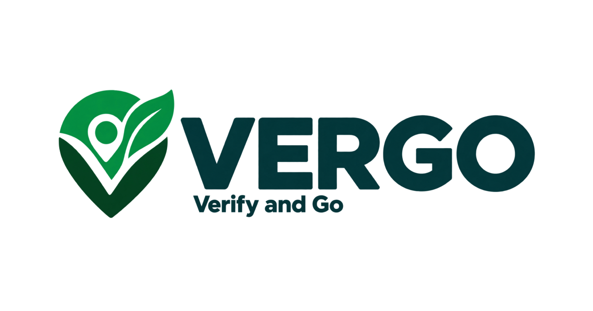
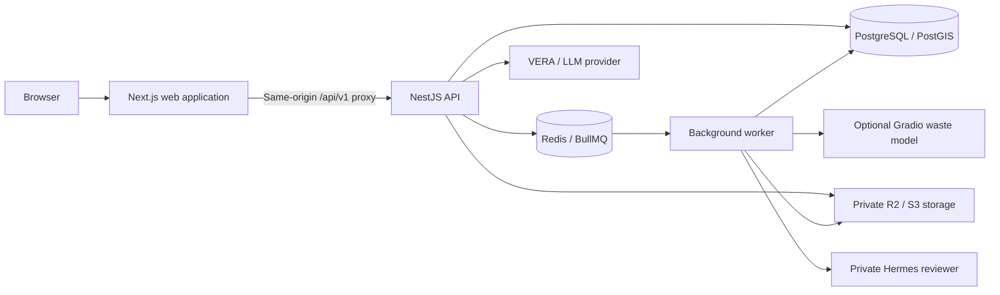

<p align="center">
  <a href="https://vergo.venlab.tech/">
    
  </a>
</p>

<h1 align="center">VERGO · Verify and Go</h1>

<p align="center">
  <strong>Photo evidence. Verified reports. Community action.</strong><br />
  Multimodal artificial intelligence and geospatial intelligence for waste reporting and follow-up.
</p>

<p align="center">
  <a href="https://vergo.venlab.tech/"></a>
  <a href="https://github.com/Nexuszzz/VERGO"></a>
</p>

<p align="center">
  
  
  
  
  
  
</p>

<p align="center">
  <a href="#overview">Overview</a> ·
  <a href="#sdg-11-and-sdg-12">SDG 11 + SDG 12</a> ·
  <a href="#features">Features</a> ·
  <a href="#architecture">Architecture</a> ·
  <a href="#getting-started">Getting started</a> ·
  <a href="#documentation">Documentation</a> ·
  <a href="README.id.md">Bahasa Indonesia</a>
</p>

---

## Overview

**VERGO turns everyday observations into structured environmental reports that people can review and act on.** Optional image analysis can suggest waste material categories; reports also record location, time, and context. Human moderators decide which evidence can be verified and shared. Community and volunteer features can document follow-up action.

The platform brings this workflow together with personal dashboards, geospatial information, and **VERA**, a virtual assistant for VERGO guidance and environmental information.

For **FunDev International Competition 2026**, VERGO focuses on **SDG 11 as its primary goal** (Sustainable Cities and Communities, target **11.6**) and **SDG 12 as its supporting goal** (Responsible Consumption and Production, targets **12.5 and 12.8**). The product follows **Photo. Verify. Follow up.**: from citizen observations to reviewed environmental information and documented responses.

**Live application: [vergo.venlab.tech](https://vergo.venlab.tech/).** English is the default interface language. Users can choose Indonesian in Settings; their preference is saved. An existing Indonesian preference continues to apply on return visits.

**Submission repository: [Nexuszzz/VERGO](https://github.com/Nexuszzz/VERGO).** This repository starts with a source snapshot; see [repository provenance](docs/REPOSITORY_PROVENANCE.md) for its origin and relationship to the operational repository.

## SDG 11 and SDG 12

| Role | Goal and target | Traceable contribution from VERGO |
| --- | --- | --- |
| **Primary — SDG 11** | **11.6:** reduce the adverse environmental impact of cities, with attention to municipal and other waste management. | Photo evidence, location, time, and context form a structured report. Moderators review evidence and duplicates. Eligible incidents appear in H3 area summaries; updates and outcome evidence help track follow-up. |
| **Supporting — SDG 12** | **12.5:** prevent, reduce, recycle, and reuse waste. | Optional material recognition and handling guidance help users understand possible actions. Community activities can record handling outcomes; quantities or weights require reviewed measurements. |
| **Supporting — SDG 12** | **12.8:** provide information and awareness for sustainable development and lifestyles in harmony with nature. | Material education, VERA, reporting guidance, and activity records support citizen understanding. Behaviour change still requires user evaluation. |

Sources: [UN SDG 11](https://sdgs.un.org/goals/goal11) and [UN SDG 12](https://sdgs.un.org/goals/goal12). The [SDG alignment document](docs/SDG_ALIGNMENT.md) maps features, evidence, evaluation measures, and claim boundaries in detail.

1. **Document.** Citizens submit photos from a safe distance, location, time, and context. Reports can be created without an AI scan.
2. **Review.** Human moderators inspect evidence, request missing information, and handle duplicates. AI suggestions do not determine verification.
3. **Explore.** Eligible incidents appear in public summaries and area maps. Private originals and precise coordinates are not automatically published.
4. **Follow up.** Condition updates, assignments, and community activities can record progress and outcome evidence. Resolution requires separate evidence and review.

**Verification and resolution are separate statuses.** Low/medium/high map levels describe report concentration; they are not pollution measurements. An area without reports is not necessarily clean. VERGO supports records and accountability; it does not automatically dispatch cleaning teams or establish achievement of official SDG indicators from report counts.

Relevant pilot measures include **unique verified incidents, moderator review time, evidence completeness, documented follow-up, and reviewed activity outcomes**. Verified waste weights require units, methods, batch/stage information, and evidence. Collected, transferred, and recycled amounts from the same waste must not be added together as separate impact. Demonstration data should be labelled as test data.

## Features

| Feature | Purpose |
| --- | --- |
| **Optional waste recognition** | Capture or upload a photo for material suggestions when the model service is available. EcoLens ML is not enabled on the current VPS deployment. |
| **Evidence-based reports** | Submit photos, location, and context; follow reports through human moderation. |
| **Public incidents and area maps** | Explore eligible, moderator-reviewed reports and H3 summaries of report concentration and recurrence. Public visibility is controlled separately from private evidence. |
| **Personal dashboard** | View scan/report history, points, achievements, notifications, and account settings. |
| **VERA assistant** | Ask for feature guidance and environmental information. Permitted account tools are read-only. |

### Community and operational modules

| Module | Purpose |
| --- | --- |
| **Community updates** | Record follow-up evidence and support review of changing conditions. |
| **Volunteer activities** | Organise clean-up activities, manage participants, and record attendance and outcomes. |
| **Impact summaries** | Present recorded activity outcomes and participation. |
| **Hermes-assisted review** | Prepare structured evidence recommendations for human moderators. |
| **Instagram workflow** | Prepare and publish approved content through consent and publication controls. |

These modules use feature flags and require their migrations and supporting services. Example environments disable extensions by default. Consult the [project summary](docs/RINGKASAN_PROYEK.md) for dated evidence and the [active plan](docs/RENCANA_FUNDEV_2026.md#gerbang-rilis) for remaining acceptance work.

### Product workflow

**Observe → Document → Submit → Human review → Explore → Follow up**

Scanning is optional and can suggest material categories. Public reports go through moderation. Geospatial summaries describe eligible recorded reports and historical patterns. VERA provides guidance without changing account data or report status; Hermes recommendations require human review.

## Architecture



| Layer | Technology |
| --- | --- |
| Frontend | Next.js 16 App Router, React 19, TypeScript |
| Styling and motion | Tailwind CSS 4, Motion, Lucide icons |
| Maps and spatial indexing | Mapbox GL JS, Leaflet, PostGIS, H3 |
| HTTP API | NestJS 12, versioned REST under `/api/v1` |
| Persistence and search | PostgreSQL, SQL migrations, pgvector, full-text search |
| Background processing | Redis and BullMQ |
| Media | Private Cloudflare R2 / S3-compatible object storage |
| Waste inference | Self-hosted Gradio service with the EcoLens model |
| Assistant | LangGraph and an OpenAI-compatible LLM provider |
| Contracts | OpenAPI schemas, generated TypeScript types, shared fixtures |

### Repository layout

```text
.
├── apps/
│   ├── web/               Next.js frontend and same-origin API proxy
│   ├── api/               NestJS API, migrations, and server-side tests
│   └── worker/            Scan processing and background jobs
├── packages/config/       Shared environment validation
├── contracts/             Published OpenAPI contract and fixtures
│   └── r1/                Draft extension contract
├── services/hermes-review/ Private assisted-review service
├── deploy/                Docker, database backups, and service configuration
├── scripts/               Contract, route, and commit-metadata checks
├── bench/                 Performance benchmark tools
└── docs/                  Product, design, integration, and operational guides
```

VERGO is a new implementation inspired by EcoLens. The legacy `ecoLens` and `ecoLens_ML` source repositories remain references and must not be copied into this repository or added as submodules/subtrees. The existing model provides waste inference through a Gradio integration. See the [source audit](docs/SOURCE_AUDIT.md).

### Branding and technical compatibility

The public product is **VERGO — Verify and Go**, and its assistant is **VERA**. Older documents may use the previous names SAP and SAPA.

Existing technical identifiers remain unchanged: npm packages such as `@sap/web`, environment variables starting with `SAP_` or `SAPA_`, the `sapaEnabled` preference field, asset paths, and deployment paths such as `/etc/sap/`. Use these identifiers exactly as documented when configuring the application.

### Deployment status

The operational repository's `main` branch supplies the current VPS release. This submission repository has its own history and does not trigger an update to that server. Web, API, worker, PostgreSQL/PostGIS/pgvector, and Redis run on the VPS; object storage remains on Cloudflare R2. VERA uses a private 9Router gateway, and the Hermes reviewer remains private. EcoLens ML is not installed on that deployment; manual reporting, moderation, and maps can operate without scanning.

The [VPS runbook](docs/DEPLOYMENT_VPS.md) describes release paths, private configuration, checks, and rollback. Credentials, database dumps, and provider backups are excluded from Git.

## Getting started

### 1. Prepare the environment

Use **Node.js 22 or later** and npm. API and worker dependencies include:

- PostgreSQL with **PostGIS**, **pgvector**, and **pg_trgm** available.
- Redis and a private S3-compatible bucket, such as Cloudflare R2.
- Transactional email through Resend, or SMTP for local development.
- A Gradio inference service and its credentials when exercising the scanning workflow.

The included [PostgreSQL Dockerfile](deploy/postgres.Dockerfile) provides PostGIS and pgvector. The [deployment Compose file](deploy/compose.yml) expects operator-managed configuration under `/etc/sap/` and an external ML network. Follow the [deployment guide](docs/DEPLOYMENT.md) to prepare that environment; the Compose file is not a complete one-command local setup.

### 2. Configure the application

For a new working copy:

```sh
git clone https://github.com/Nexuszzz/VERGO.git
cd VERGO
cp .env.example .env
cp apps/web/.env.example apps/web/.env.local
npm ci
git config core.hooksPath .githooks
```

Run commands from the repository root. Keep any existing configured environment files. Replace example values with your private service configuration; validation rejects placeholder credentials.

| Setting | Purpose |
| --- | --- |
| `APP_ORIGIN` | Browser-facing origin; use `http://localhost:3000` locally. |
| `API_INTERNAL_URL` | Server-side API address; use `http://localhost:3001` locally. Also set it in `apps/web/.env.local`. |
| `DATABASE_URL`, `DATABASE_DIRECT_URL` | Runtime database connection and optional direct migration connection. |
| `REDIS_URL` | Native Redis connection URL for background processing. |
| `SESSION_SECRET`, `CSRF_SECRET` | Independent random secrets, each at least 32 characters. |
| `MAIL_TRANSPORT`, mail settings | Transactional email; Resend is the default, SMTP supports local development. |
| `S3_*` | Private storage endpoint, bucket, and access credentials. |
| `ML_*` | Gradio endpoint, prediction route, credentials, and timeout. |

The proxy uses `API_INTERNAL_URL` and accepts the legacy alias `SAPA_API_BASE_URL`. Keep provider credentials server-side and out of `NEXT_PUBLIC_*`. Environment files must remain uncommitted. The complete configuration reference starts in [`.env.example`](.env.example).

### 3. Build shared packages and apply migrations

```sh
npm run build
npm run migrate -w @sap/api
```

Migrations prefer `DATABASE_DIRECT_URL` when available. The database role must have permission to install required extensions and apply schema changes.

### 4. Run three processes

Run each command in a separate terminal from the repository root:

| Process | Command | Default address |
| --- | --- | --- |
| API | `npm run dev:api` | `http://localhost:3001` |
| Worker | `npm run dev:worker` | Background process |
| Web | `npm run dev:web` | `http://localhost:3000` |

Open **[localhost:3000](http://localhost:3000)**. Check **[API readiness](http://localhost:3000/api/v1/health/ready)**, confirm `data.ready` is `true`, and review dependency status. Create an account and verify the emailed code before using the dashboard. End-to-end scanning requires healthy Redis, private storage, a running worker, and a working Gradio integration.

<details>
<summary><strong>Enable optional capabilities</strong></summary>

Enable VERA with `SAPA_FEATURE_ENABLED=true` and configure `SAPA_LLM_BASE_URL`, `SAPA_LLM_API_KEY`, and `SAPA_LLM_MODEL`. These settings retain their original `SAPA_` prefix. Read the [assistant guide](docs/SAPA_ASSISTANT.md) before enabling hybrid retrieval.

Community and activity features use `SAP_EXTENSION_ENABLED` together with `SAP_COMMUNITY_ENABLED` and `SAP_ACTIVITIES_ENABLED`. Hermes uses `SAP_HERMES_ENABLED` and its [private service configuration](services/hermes-review/README.md). Instagram rendering and publishing have separate flags and require Meta integration, consent, and publication approval.

Apply the relevant migrations and configure dependencies before enabling a module. Restart affected processes after changing environment settings. See the [integration contract](docs/CONTRACT_ZAKA_ZAMANI.md) and [active plan](docs/RENCANA_FUNDEV_2026.md).

</details>

<details>
<summary><strong>Open the development app from another device</strong></summary>

Set server-side `APP_ORIGIN` to the exact frontend URL, for example `http://192.168.1.20:3000`. In `apps/web/.env.local`, set `SAP_ALLOWED_DEV_ORIGINS=192.168.1.20` using only the hostname/IP. Restart server-side services and start the web app with:

```sh
npm run dev:web -- --hostname 0.0.0.0
```

Open `http://192.168.1.20:3000` from another device, replacing the example IP with your host's address.

</details>

## Development and validation

Run commands from the repository root:

| Command | Purpose |
| --- | --- |
| `npm run build` | Build the config package, API, and worker. |
| `npm run build -w @sap/web` | Build the production web application. |
| `npm run typecheck` | Check TypeScript across npm workspaces. |
| `npm run contracts:check` | Validate contracts and fixtures. |
| `npm run contracts:routes` | Compare API routes with the draft extension contract. |
| `npm run contracts:types -w @sap/web` | Regenerate types from the published API contract. |
| `npm run contracts:r1:types -w @sap/web` | Regenerate types from the R1 draft. |
| `npm run test` | Run workspace tests and Python Hermes tests. |
| `npm run test:r1 -w @sap/web` | Run the web Playwright suite. |
| `npm run check` | Run contract validation, type checks, tests, server builds, and route checks. |
| `node scripts/check-git-attribution.mjs --all` | Audit author, committer, and co-author identities in reachable local history. |

For application changes, run `npm run check` before committing. For documentation-only changes, inspect links, referenced assets, and command examples. The Hermes test script uses POSIX shell syntax and `python3`; on Windows, use WSL or Git Bash with Python available. Playwright needs its browser dependencies and configured environment. Database integration tests require a dedicated test database; see the [test plan](docs/TEST_PLAN.md).

The published API contract is `1.1.0`; the R1 extension schema is draft `1.2.0`. Changes to API behaviour must keep handlers, schemas, fixtures, and generated frontend types aligned. Local checks validate the repository; external-service and deployment acceptance belongs in the [release gates](docs/RENCANA_FUNDEV_2026.md#gerbang-rilis). Historical results are dated in the [project summary](docs/RINGKASAN_PROYEK.md).

### Commit attribution

Configure your own Git name and GitHub-linked email before committing. Run `git config core.hooksPath .githooks` once per clone to enable the included author, committer, co-author, and pre-push checks. Their purpose is to keep commits attributed to responsible human contributors. Hooks are local safeguards; they can be bypassed, so inspect metadata before publishing. Human team credit and third-party notices remain part of the project.

## Documentation

Most detailed engineering documents are currently in Indonesian. The English README provides the main entry point.

| Guide | Reference |
| --- | --- |
| [Documentation index](docs/README.md) | Maintained guides and source contracts. |
| [Project summary](docs/RINGKASAN_PROYEK.md) | Existing features, decisions, navigation, and dated evidence. |
| [SDG alignment](docs/SDG_ALIGNMENT.md) | SDG 11 primary, SDG 12 supporting, evidence, pilot measures, and claim boundaries. |
| [FunDev 2026 plan](docs/RENCANA_FUNDEV_2026.md) | Demonstration flow, feature status, and release gates. |
| [ITASE notes](docs/RENCANA_ITASE_2026.md) | Archived requirements from an earlier competition. |
| [Product requirements](docs/PRD.md) | Goals, users, and baseline scope. |
| [Architecture](docs/TECH_SPEC.md) | Technology and domain boundaries. |
| [VERA guide](docs/SAPA_ASSISTANT.md) | Assistant behaviour and configuration. |
| [Published API](contracts/openapi.json) / [R1 draft](contracts/r1/README.md) | Machine-readable schemas and promotion rules. |
| [Extension contract](docs/CONTRACT_ZAKA_ZAMANI.md) | Shared frontend/backend DTOs and workflows. |
| [Moderation](docs/CONTENT_OPERATIONS.md) | Human review, privacy, and operations. |
| [Deployment guide](docs/DEPLOYMENT.md) / [VPS runbook](docs/DEPLOYMENT_VPS.md) | Runtime configuration, 9Router/Hermes, and recovery. |
| [Repository provenance](docs/REPOSITORY_PROVENANCE.md) | Source snapshot, human credits, and repository relationship. |

## Team and acknowledgements

Existing development history credits **[Naufal Muhammad Dzaka (Nexuszzz)](https://github.com/Nexuszzz)** and **[sitaurs](https://github.com/sitaurs)**. This submission snapshot preserves that acknowledgement. Frameworks, model integrations, fonts, and other third-party components retain their applicable notices and terms.

---

<p align="center">
  <strong>Cleaner places start with someone who cares enough to act.</strong><br />
  <a href="https://vergo.venlab.tech/">Open VERGO →</a>
</p>
